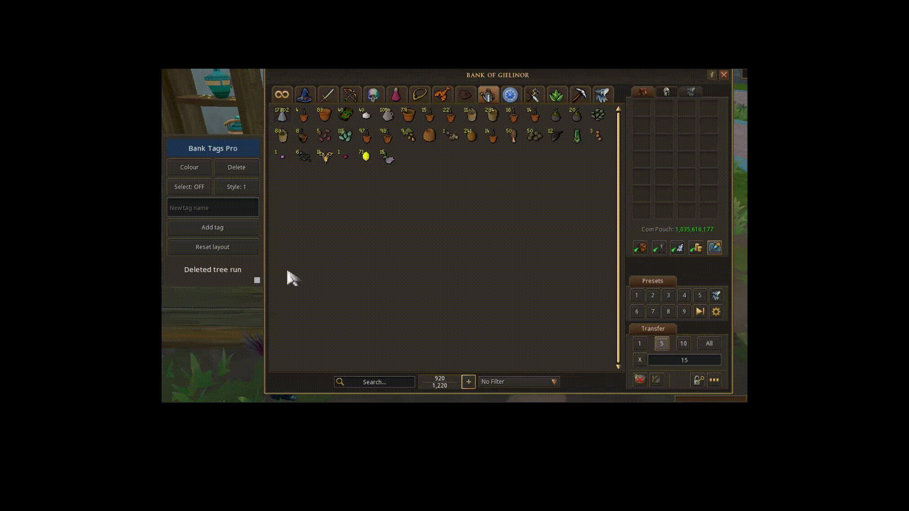

# Bank Tags Pro

A quality-of-life plugin for **RuneScape 3**, written in Lua against the official
[RuneScape Client API](https://developer.runescape.com/rs/). Tag the items in your bank,
then pick a tag in a small tab next to the bank and every item with that tag lights up.

> Inspired by the Bank Tags plugin of RuneLite (OSRS). Not affiliated with or endorsed by Jagex.
> English | [Português](README.pt-BR.md)

## Project Status: Discontinued

Development of Bank Tags Pro has been discontinued. The project is preserved as a portfolio and learning project, showcasing its implementation using the RuneScape 3 Plugin API.

## Demo



*Create a tag, add items with the menu and Select mode, then change the outline style and colour.*

## Features

- **Side tab next to the bank**: one button per tag. Click a tag and the bank items that carry it
  glow in the tag's colour; click another tag and the glow switches; click it again to turn it off.
  The tab exists only while the bank is open, and the glow turns off when the bank closes.
- **Your own tags**: create tags with any name (for example "Vindicta" or "Tree run"), delete them,
  and give each one a colour (12 colours). Five starter tags are included.
- **Select mode**: with a tag selected, switch Select on and left-click items to add them to / remove
  them from the tag. The click does *not* withdraw the item while the mode is on.
- **Right-click menu**: Shift + right-click an item for `Add to / Remove from <tag>` and
  `Remove all tags`; a plain right-click on a tagged item shows its tags.
- **Outline styles**: thickness 1-3 and optional pulsing.
- **Movable and resizable tab**: drag the title bar to move it, drag the corner square to resize it.
  It follows the bank window if you move or resize that.
- **Plugin window**: lists the items of each tag by name (open it from the plugin's ribbon icon).
- Tags are saved per **item ID**, so every copy of an item shares its tags, and they survive restarts.

The plugin only draws click-through rectangles and adds menu entries that run local Lua code.
It never sends actions to the server, never moves items and never changes your bank.

## Requirements

- RuneScape 3 with the Jagex **plugin development beta client** (see
  [Getting started with the API](https://developer.runescape.com/rs/getting-started.html)).
- Windows, with the client's `dev_plugins` folder, normally
  `C:\ProgramData\Jagex\RuneScape-BETA\dev_plugins\`.

## Installation

1. Copy the folder `plugin/bank-tags-pro` of this repository into `dev_plugins` so that you get
   `...\dev_plugins\bank-tags-pro\main.lua`. (Or run `python scripts/package.py` and extract the
   ZIP from `dist/` there.)
2. Open the client's developer console with `ALT` + `` ` `` (the key below `ESC`).
3. Run `prf` (refresh the plugin list), then `plist` to check that `bank-tags-pro` is listed.
4. Run `pon bank-tags-pro` to enable it. The console prints `[BankTagsPro] loaded...`.

After editing any file run `prl bank-tags-pro` to reload. `poff bank-tags-pro` disables it.
Edit `contactEmailAddress` in `plugin/bank-tags-pro/plugin.json` if you publish your own build.

## Using it

1. **Tag items.** Open the bank, hold `Shift` and right-click an item, then choose a tag.
2. **Show a tag.** A tab appears right of the bank. Click a tag in it: its items glow.
3. **Tag faster.** With a tag selected click **Select: OFF** (it becomes **Select: ON**) and
   left-click items to add or remove them. Click **Select: ON** again to go back to normal clicks.
4. **New tag.** Type a name in the text field of the tab and press `Enter` or click **Add tag**.
5. **Delete a tag.** Select it and press **Delete** twice (the button asks `Sure?`).
6. **Colour and style.** **Colour** cycles the selected tag's colour; **Style** cycles thickness/pulse.
7. **Move / resize.** Drag the title bar / the grey corner square. **Reset layout** restores defaults.

## Configuration

Everything you may want to change is in
[`plugin/bank-tags-pro/src/config.lua`](plugin/bank-tags-pro/src/config.lua): default tags and
colours, limits, outline styles, which interface slots count as "the bank", tab sizes and more.
Set `DEBUG = true` there for detailed console diagnostics.

## Project layout

```
plugin/bank-tags-pro/      the plugin itself (copy this folder to dev_plugins)
  main.lua                 entry point: wires the modules to the client events
  plugin.json              plugin manifest
  src/                     one module per concern (see docs/ARCHITECTURE.md)
docs/                      architecture, API notes, troubleshooting, publishing checklist
docs/media/                GIFs used by the README
scripts/package.py         builds dist/bank-tags-pro-<version>.zip
scripts/check_lua.py       heuristic static checker (works without a Lua interpreter)
```

## Development

```
python scripts/check_lua.py plugin/bank-tags-pro   # blocks, undeclared names, module fields, cycles
python scripts/package.py                          # build the ZIP into dist/
```

The checker is heuristic (it is not a Lua parser). [`.luacheckrc`](.luacheckrc) is provided if you
prefer [luacheck](https://github.com/lunarmodules/luacheck). The plugin has only been tested by hand
in the beta client, so please report anything odd together with the console output
(`DEBUG = true` adds the details that matter).

## Notes and limitations

- Some details come from observation rather than documentation (interface IDs of the bank, how a
  slot exposes its item). They are listed in [docs/API-NOTES.md](docs/API-NOTES.md); a game update
  could change them, and the config file is where to adjust them.
- Tags are stored with the plugin in `PersistentDB`, which belongs to this computer: all characters
  on it share the same tags.
- Tags only apply to the bank's own item grid, not to the backpack.
- The bank's native search box cannot be extended by plugins; use the tab instead.

## License

[MIT](LICENSE).
