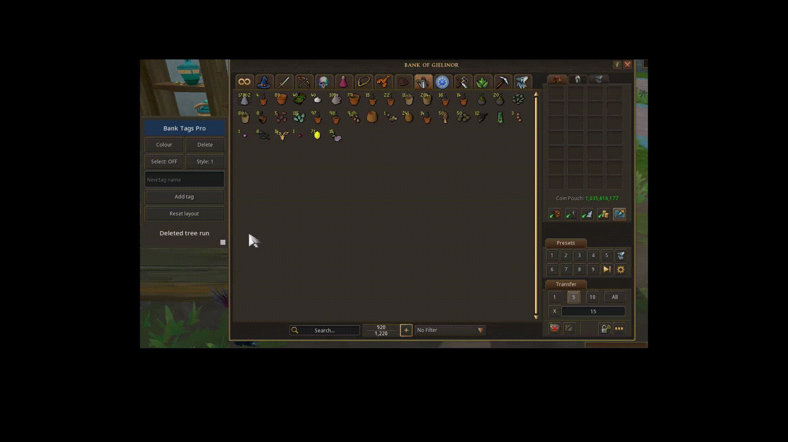

# Bank Tags Pro

Plugin de qualidade de vida para **RuneScape 3**, escrito em Lua com a
[API oficial do cliente](https://developer.runescape.com/rs/). Marque os itens do banco com
tags, escolha uma tag numa pequena aba ao lado do banco e todos os itens daquela tag acendem.

> Inspirado no plugin Bank Tags do RuneLite (OSRS). Sem ligação com a Jagex.
> [English](README.md) | Português

## Status do projeto: Descontinuado

O desenvolvimento do Bank Tags Pro foi encerrado. O projeto permanece público como parte do meu portfólio e como registro de aprendizado, demonstrando sua implementação utilizando a API de plugins do RuneScape 3.

## Demonstração



*Criar uma tag, adicionar itens pelo menu e pelo modo Select e trocar o estilo e a cor do contorno.*

## Funções

- **Aba ao lado do banco**: um botão por tag. Clique numa tag e os itens do banco com ela brilham
  na cor da tag; clique em outra e o brilho muda; clique de novo para apagar. A aba só existe com o
  banco aberto, e o brilho desliga quando o banco fecha.
- **Tags próprias**: crie tags com qualquer nome (por exemplo "Vindicta" ou "Tree run"), apague-as e
  dê uma cor a cada uma (12 cores). Cinco tags iniciais já vêm prontas.
- **Modo Select**: com uma tag escolhida, ligue o Select e clique nos itens com o botão esquerdo
  para adicioná-los à tag ou tirá-los dela. Com o modo ligado, o clique *não* retira o item do banco.
- **Menu de botão direito**: Shift + botão direito num item mostra `Add to / Remove from <tag>` e
  `Remove all tags`; o botão direito normal num item com tag mostra as tags dele.
- **Estilos do contorno**: espessura de 1 a 3 e pulsação opcional.
- **Aba movível e redimensionável**: arraste a barra de título para mover e o quadradinho do canto
  para redimensionar. Ela acompanha a janela do banco se você a mover ou redimensionar.
- **Janela do plugin**: lista os itens de cada tag pelo nome (pelo ícone do plugin no cliente).
- As tags são salvas pelo **ID do item**: todas as cópias de um item dividem as tags, e elas
  sobrevivem a reinícios.

O plugin só desenha retângulos que não interceptam cliques e adiciona entradas de menu que rodam
código Lua local. Nunca envia ações ao servidor, nunca move itens e nunca altera o banco.

## Requisitos

- RuneScape 3 com o **cliente beta de desenvolvimento de plugins** da Jagex (veja
  [Getting started with the API](https://developer.runescape.com/rs/getting-started.html)).
- Windows, com a pasta `dev_plugins` do cliente, normalmente
  `C:\ProgramData\Jagex\RuneScape-BETA\dev_plugins\`.

## Instalação

1. Copie a pasta `plugin/bank-tags-pro` deste repositório para dentro de `dev_plugins`, de modo que
   exista `...\dev_plugins\bank-tags-pro\main.lua`. (Ou rode `python scripts/package.py` e extraia
   o ZIP de `dist/` lá.)
2. Abra o console de desenvolvimento do cliente com `ALT` + `` ` `` (a tecla abaixo do `ESC`).
3. Rode `prf` (atualiza a lista de plugins) e depois `plist` para conferir que `bank-tags-pro` aparece.
4. Rode `pon bank-tags-pro` para ativar. O console mostra `[BankTagsPro] loaded...`.

Depois de editar qualquer arquivo use `prl bank-tags-pro` para recarregar. `poff bank-tags-pro`
desativa. Troque o `contactEmailAddress` em `plugin/bank-tags-pro/plugin.json` se publicar sua versão.

## Como usar

1. **Marcar itens.** Com o banco aberto, segure `Shift`, clique com o botão direito num item e
   escolha uma tag.
2. **Mostrar uma tag.** Uma aba aparece à direita do banco. Clique numa tag: os itens dela brilham.
3. **Marcar mais rápido.** Com uma tag escolhida clique em **Select: OFF** (vira **Select: ON**) e
   clique com o botão esquerdo nos itens para adicionar ou remover. Clique em **Select: ON** para
   voltar aos cliques normais.
4. **Nova tag.** Digite um nome no campo da aba e aperte `Enter` ou clique em **Add tag**.
5. **Apagar tag.** Selecione-a e aperte **Delete** duas vezes (o botão pergunta `Sure?`).
6. **Cor e estilo.** **Colour** troca a cor da tag escolhida; **Style** alterna espessura e pulsação.
7. **Mover / redimensionar.** Arraste a barra de título / o quadradinho cinza do canto.
   **Reset layout** volta ao padrão.

## Configuração

Tudo que você pode querer mudar fica em
[`plugin/bank-tags-pro/src/config.lua`](plugin/bank-tags-pro/src/config.lua): tags e cores padrão,
limites, estilos de contorno, quais slots contam como "o banco", tamanhos da aba e mais.
Defina `DEBUG = true` ali para ver diagnósticos detalhados no console.

## Estrutura do projeto

```
plugin/bank-tags-pro/      o plugin (copie esta pasta para dev_plugins)
  main.lua                 ponto de entrada: liga os módulos aos eventos do cliente
  plugin.json              manifesto do plugin
  src/                     um módulo por responsabilidade (veja docs/ARCHITECTURE.md)
docs/                      arquitetura, notas da API, solução de problemas, checklist de publicação
docs/media/                GIFs usados nos READMEs
scripts/package.py         gera dist/bank-tags-pro-<versão>.zip
scripts/check_lua.py       verificador estático heurístico (funciona sem interpretador Lua)
```

## Desenvolvimento

```
python scripts/check_lua.py plugin/bank-tags-pro   # blocos, nomes não declarados, campos de módulos, ciclos
python scripts/package.py                          # gera o ZIP em dist/
```

O verificador é heurístico (não é um parser de Lua). O [`.luacheckrc`](.luacheckrc) está incluído se
você preferir o [luacheck](https://github.com/lunarmodules/luacheck). O plugin só foi testado à mão
no cliente beta; se algo estranho acontecer, relate com a saída do console (`DEBUG = true` mostra
os detalhes que importam).

## Observações e limitações

- Alguns detalhes vieram de observação e não da documentação (IDs das interfaces do banco, como um
  slot expõe o item). Estão em [docs/API-NOTES.md](docs/API-NOTES.md); uma atualização do jogo pode
  mudá-los, e o arquivo de configuração é onde ajustar.
- As tags ficam no `PersistentDB` do plugin, que pertence a este computador: todos os personagens
  da máquina dividem as mesmas tags.
- As tags só valem para a grade de itens do banco, não para a mochila.
- A barra de busca nativa do banco não pode ser estendida por plugins; use a aba.

## Licença

[MIT](LICENSE).
